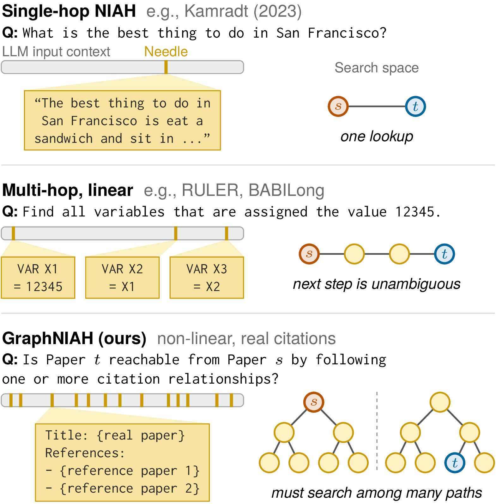
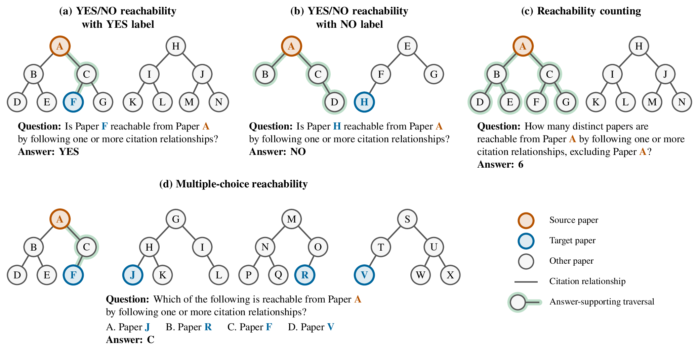
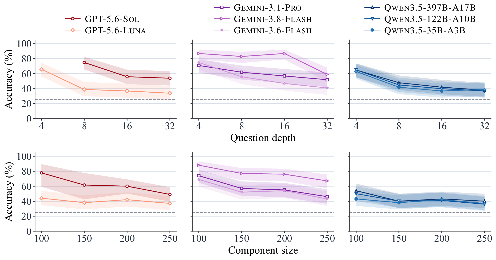
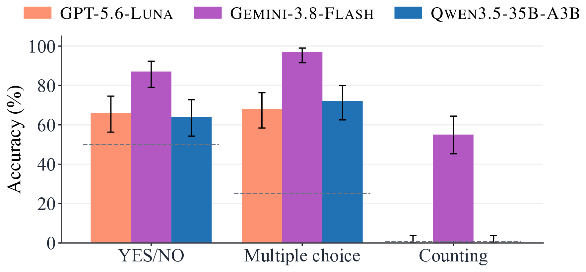
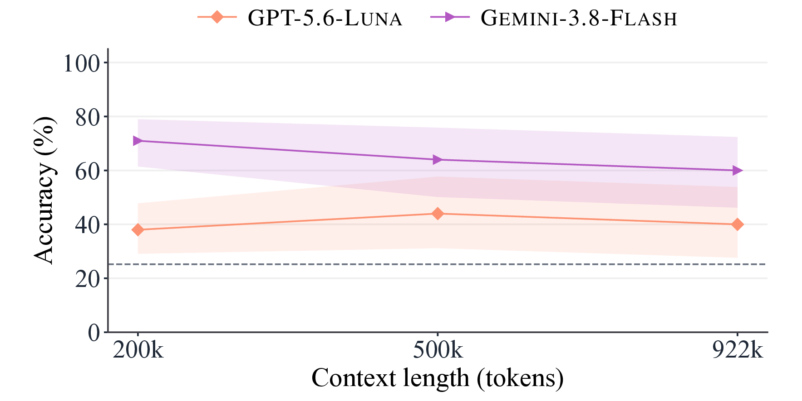
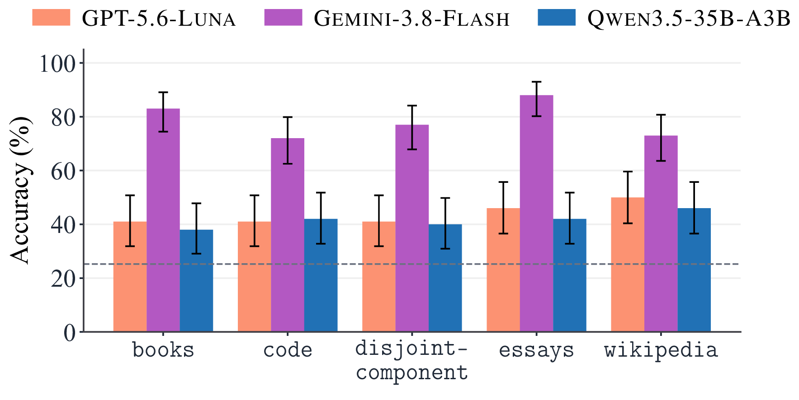
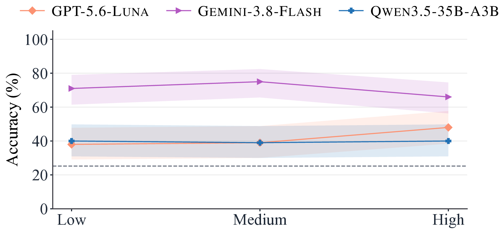

<div align="center">

# GraphNIAH: A Benchmark for Long-Context Reasoning over Real-World Graphs

**Minh-Nam Tran, Abulhair Saparov**

<!-- Paper and BibTeX badges: hidden until the paper is public; replace XXXX.XXXXX with the arXiv ID.
[](https://arxiv.org/abs/XXXX.XXXXX)
[](#citation)
-->

[](https://trminhnam.github.io/projects/graphniah/)
[](https://huggingface.co/datasets/minhnam/GraphNIAH)
[](#installation)
[](LICENSE)

</div>

GraphNIAH is a **dynamic needle-in-a-haystack (NIAH) benchmark** built from
**real citation relationships** among scientific papers. Every example asks a
model to search a citation graph that is written out in a long context
(200k to 922k tokens). All papers are published after the evaluated models'
knowledge cutoff, so the benchmark uses real-world data without benchmark
contamination. The pipeline is fully automatic: when new papers are published,
new examples can be generated without any human annotation.

This repository contains the complete pipeline: data download, path sampling,
example construction, model inference, and evaluation.

<p align="center">
  
</p>
<p align="center"><em>
Three kinds of NIAH tests. Single-hop NIAH needs one lookup. In RULER and
BABILong, the next step is always unambiguous. In GraphNIAH, the target paper
<i>t</i> can be in a different connected component from the source paper <i>s</i>,
so the model must search <b>all</b> paths from <i>s</i> to answer NO.
</em></p>

<!-- News: add the dates when the paper and the code and data are released.
## News

- **[YYYY-MM-DD]** 🎉 Paper released on [arXiv](https://arxiv.org/abs/XXXX.XXXXX).
- **[YYYY-MM-DD]** Code and data released.
-->

## Why GraphNIAH?

Existing NIAH benchmarks have at least one of four limitations:

1. They use **synthetic data**, so results may not transfer to real use cases.
2. They reuse **published datasets**, which may already be in the training data
   (benchmark contamination).
3. They need **human annotation**, so they are hard to update and scale.
4. Their multi-hop reasoning is **linear**: each next step is obvious from the
   previous step. Real tasks often need _search_ over many possible paths.
   We call this **non-linear reasoning**.

| Benchmark            | Multi-hop reasoning | Real data | Updatable | No human annotation | Non-linear reasoning |
| -------------------- | :-----------------: | :-------: | :-------: | :-----------------: | :------------------: |
| Naive NIAH           |         ❌          |    ❌     |    ✅     |         ✅          |          ❌          |
| RULER                |         ✅          |    ❌     |    ❌     |         ✅          |          ❌          |
| BABILong             |         ✅          |    ❌     |    ✅     |         ✅          |          ❌          |
| LV-Eval              |         ✅          |    ✅     |    ❌     |         ❌          |          ❌          |
| NeedleBench          |         ✅          |    ❌     |    ✅     |         ✅          |          ✅          |
| Counting-Stars       |         ✅          |    ❌     |    ✅     |         ✅          |          ❌          |
| Sequential-NIAH      |         ✅          |    ❌     |    ❌     |         ✅          |          ❌          |
| NeedleChain          |         ✅          |    ❌     |    ✅     |         ✅          |          ❌          |
| NoLiMa               |         ✅          |    ❌     |    ✅     |         ✅          |          ❌          |
| U-NIAH               |         ✅          |    ❌     |    ✅     |         ❌          |          ❌          |
| **GraphNIAH (ours)** |         ✅          |    ✅     |    ✅     |         ✅          |          ✅          |

## The three reachability tasks

Each example samples a subgraph of the
[Semantic Scholar](https://www.semanticscholar.org/product/api) citation graph.
The subgraph has several connected components. Each paper is written in the
context as a text block (title, authors, venue) with an APA-style reference
list. A paper is **reachable** from another paper if a chain of `cites` /
`cited_by` relationships _stated in the context_ connects them.

<p align="center">
  
</p>

- **YES/NO reachability:** Is target paper _t_ reachable from source paper _s_?
- **Multiple-choice reachability:** Which of four candidate papers is reachable from _s_?
  Exactly one candidate is reachable.
- **Reachability counting:** How many papers are reachable from _s_ (excluding _s_)?

**How an example is built.**

1. **Backbone:** sample a real citation path of `3k - 2` papers and split it
   into a distractor path, the true path from _s_ to _t_ (_k_ papers), and
   another distractor path. So the model needs at least _k - 1_ search steps
   from either end.
2. **Subgraph growth:** add real neighboring papers with a
   preferential-attachment rule (similar to a Chinese restaurant process with
   concentration parameter α = 0.1). This mimics the scale-free degree
   distribution of real citation graphs. Every component stays a tree.
3. **Rendering:** write each paper and its references as natural text.
4. **Distractors and packing:** add distracting content until the target
   context length is full, then shuffle all blocks.

**Control knobs** (one is varied per experiment; the others are sampled at random):

| Variable                                     | Values                                                                                            |
| -------------------------------------------- | ------------------------------------------------------------------------------------------------- |
| Question depth _k_ (papers on the true path) | 4, 8, 16, 32                                                                                      |
| Component size (papers per component)        | 100, 150, 200, 250                                                                                |
| Task                                         | YES/NO, multiple choice, counting                                                                 |
| Distractor type                              | `code` (Linux kernel), `essays` (Paul Graham), `books` (PG-19), `wikipedia`, `disjoint-component` |
| Target context length                        | 200,000 / 500,000 / 922,000 tokens                                                                |
| Reasoning effort                             | low, medium, high                                                                                 |

## Key findings

We evaluate eight LLMs: **GPT-5.6-Sol**, **GPT-5.6-Luna**, **Gemini-3.1-Pro**,
**Gemini-3.8-Flash**, **Gemini-3.6-Flash**, **Qwen3.5-397B-A17B**,
**Qwen3.5-122B-A10B**, and **Qwen3.5-35B-A3B**. Shaded bands and error bars are
95% Wilson confidence intervals. The dashed gray line is random guessing.

### 1. Accuracy falls as the reasoning path gets longer

<p align="center">
  
</p>

- Accuracy drops with question depth for **every** model. GPT-5.6-Luna and the
  Qwen3.5 models fall from 63–66% at _k_ = 4 to 34–42% at larger depths.
- Even the best model, Gemini-3.8-Flash, stays at 83–87% up to _k_ = 16 but
  drops to 59% at _k_ = 32.
- At _k_ ≥ 16, the GPT-5.6 and Qwen3.5 models answer **NO to almost every
  YES/NO question**, so they do no better than random guessing.
- Larger components mainly hurt the stronger models (GPT-5.6-Sol and the
  three Gemini models fall from 69–88% to 43–67%).

### 2. Counting is the hardest task

<p align="center">
  
</p>

- **Four of the eight models answer no counting example correctly**, at any
  question depth or component size.
- For the other four models, counting accuracy falls sharply with component
  size: from 100 to 250 papers, Gemini-3.8-Flash drops from 79% to 25%, and
  the other three drop to 5% or less.

### 3. Models stop searching once a "negative" answer is available

Multiple choice looks easier than YES/NO, because one option is always
correct. To test this, we added a fifth option, _"None of these targets is
reachable from the source."_, which is **never** correct:

| Model            | Before (4 options) | After (+ "None") | Change |
| ---------------- | -----------------: | ---------------: | -----: |
| GPT-5.6-Luna     |              68.00 |            14.00 | −54.00 |
| Qwen3.5-35B-A3B  |              72.00 |            15.00 | −57.00 |
| Gemini-3.8-Flash |              97.00 |            97.00 |  +0.00 |
| Random guessing  |              25.00 |            20.00 |  −5.00 |

GPT-5.6-Luna and Qwen3.5-35B-A3B choose "None" in 85 and 84 of 100 examples
and produce about **half as many reasoning and output tokens**. This suggests
that they stop searching early and fall back to the negative answer, as they
do on YES/NO questions.

### 4. Context length, distractor type, and reasoning effort matter less

<p align="center">
  
  
  
</p>

- **Context length** (200k → 922k tokens): no significant change
  (Fisher's exact test, all _p_ > 0.1).
- **Distractor type:** no pair of distractor types differs significantly after
  Holm correction.
- **Reasoning effort:** more effort does not reliably help. Only GPT-5.6-Luna
  improves (38% → 48%), at the cost of 8× more output tokens, 4.7× longer
  response time, and 30% higher API cost.

**Takeaway:** current LLMs often stop exploring the citation graph before they
reach the answer, even though every fact they need is in the context.

## Installation

Requires Python 3.12, Java 21 or newer, and Spark. Full runs need Linux; the
tests also run on macOS. Run all commands from the repository root.

```bash
git clone https://github.com/trminhnam/GraphNIAH.git
cd GraphNIAH

conda create -n graphniah python=3.12 -y
conda activate graphniah
export PYSPARK_PYTHON="$(command -v python)"
export PYSPARK_DRIVER_PYTHON="$PYSPARK_PYTHON"
python -m pip install -r requirements.txt
cp .env.example .env
```

Fill in `.env` with your own credentials. **Never commit this file.**
`SEMANTIC_SCHOLAR_API_KEY` is needed for bulk downloads. Model inference needs
the selected provider's key: `OPENAI_API_KEY` for GPT models, `GEMINI_API_KEY`
for Gemini models, and `OPENROUTER_API_KEY` for the Qwen3.5 models. Some Hugging Face tokenizers may require
`HF_TOKEN` and access to their repositories. For direct Python commands, export
the environment first:

```bash
set -a
source .env
set +a
```

Optional PDF and dense-search utilities, which the pipeline below does not
use, need `requirements-optional.txt`.

## Quick start

Check the installation with the offline test suite. It uses small synthetic
graphs and mocked model responses, so it needs no downloads and no API calls:

```bash
make test
```

The full pipeline has six stages, plus an optional export. Each stage reads the output of the previous one:

| Stage                              | Command (details below)                                                                       | Main output                                                   |
| ---------------------------------- | --------------------------------------------------------------------------------------------- | ------------------------------------------------------------- |
| 1. Download and index bulk data    | `bash scripts/prepare_bulk.sh`                                                                | `resources/semantic_scholar_bulk/index/`                      |
| 2. Sample and expand paths         | `bash scripts/path_sampling.new/2026-04-01/*.sh`                                              | `sampled_paths.json`, graph database                          |
| 3. Disjoint groups and distractors | `create_data.0_disjoint_path_groups.sh`, `prepare_file_distractors.py`, `build_wiki_index.py` | `disjoint_path_groups.json`, `resources/distracting_content/` |
| 4. Generate the dataset            | `bash scripts/experiments/v1/create_data.*.sh`                                                | `output/experiments.v1/.../experiment.jsonl`                  |
| 5. Inference                       | `bash scripts/experiments/v1/inference.sh`                                                    | `.../inference/.../model=<slug>.json`                         |
| 6. Evaluation                      | `bash scripts/experiments/v1/eval.sh`                                                         | `.../eval/.../model=<slug>.json`                              |
| 7. Export the examples (optional)  | `bash scripts/experiments/v1/export_examples.sh`                                              | `output/huggingface_dataset/examples.jsonl`                   |

> [!WARNING]
> Stages 1–2 download and process the full Semantic Scholar corpus. They need
> a large machine (hundreds of GB of disk and a large Spark heap). Stage 5 makes
> **paid API calls**. Start with the small runs shown in each section.

## Full pipeline

### 1. Download and index the bulk data

```bash
RELEASE_ID=2026-10-06 CPUS=16 DRIVER_MEMORY=96g \
  bash scripts/prepare_bulk.sh
```

This downloads and decompresses `papers`, `paper-ids`, and `citations` into
`resources/semantic_scholar_bulk/raw_datasets/`. It then builds Parquet tables
under `resources/semantic_scholar_bulk/index/`, including paper metadata,
canonical IDs, both citation directions, and title lookup indexes.
It resumes completed tables rather than deleting an existing index.

Use the same release for the whole reproduction, and do not mix releases in
one raw-data directory.

The bulk pipeline needs substantial disk space and memory. The index launcher
defaults to 16 Spark workers and a 96 GB driver heap. Sampling and expansion
use shared client defaults of `local[64]` and `128g` in
`src/clients/semantic_scholar_bulk_client.py`. Adjust these for your machine;
smaller heaps may be insufficient for the full corpus. Spark temporary storage
should have enough free space for spills. No bulk download is included here.

### 2. Sample paths and expand the graph

```bash
bash scripts/path_sampling.new/2026-04-01/sample_paths_bulk_graph.sh
bash scripts/path_sampling.new/2026-04-01/expand_path_neighborhood.sh
```

The sampling settings are in
`scripts/path_sampling.new/2026-04-01/path_sampling_settings.sh`:

| Setting                                         | Value         |
| ----------------------------------------------- | ------------- |
| Earliest paper publication date                 | `2026-04-01`  |
| Fields of study                                 | `all`         |
| Input path lengths, in papers                   | `10 22 46 94` |
| Requested paths per length                      | `10000`       |
| Maximum paths containing each paper, per length | `1`           |
| Random seed                                     | `1`           |

Question depth `k` counts papers on the gold path. Construction needs input
paths with `3k - 2` papers, so depths `4, 8, 16, 32` use lengths
`10, 22, 46, 94`. Despite the CLI name `--num-hops` and the `hops=` directory
names, these lengths count **papers, not edges**. The sampler may follow a
citation in either direction. The requested number of paths is a target;
the sampler can stop earlier when eligible paths are exhausted.

Outputs are:

```text
output/data.2026-04-01/hops=<length>/papers-only/sampled_paths.json
resources/semantic_scholar_graph.2026-04-01/semantic_scholar_paths.db
```

Sampling first stores the path papers. Expansion then fetches their citation
neighborhoods from the bulk index. The supplied launcher uses `--max-level 20`:
levels 0–19 are expanded and level 20 is stored. This can be a large operation.
It resumes from database checkpoints. Finish expansion before generating
examples; generation treats the database as immutable.

If you change the cutoff or category, keep the sampling settings and
`scripts/experiments/v1/config.sh` consistent.

### 3. Prepare disjoint groups and distractors

```bash
NUM_WORKERS=4 bash scripts/experiments/v1/create_data.0_disjoint_path_groups.sh
```

This writes `disjoint_path_groups.json` beside each path file. Rebuild these
caches after changing the paths, graph database, or cutoff. Dataset v1 uses
groups of two paths for YES/NO and counting questions, and four paths for
four-option multiple choice.

Prepare the four corpus-based distractor sources. For code, first obtain a
local Linux source checkout and pass its directory:

```bash
git clone --depth 1 https://github.com/torvalds/linux.git /path/to/linux
python prepare_file_distractors.py code --code-source /path/to/linux
python prepare_file_distractors.py essays
python prepare_file_distractors.py books
python build_wiki_index.py --skip-dense
```

`prepare_file_distractors.py` reproduces the original preprocessing:

- **Code:** keep `.c`, `.h`, `.cpp`, and `.hpp` files with 1,000–2,000
  nonblank lines, remove blank lines, and flatten relative paths into filenames.
- **Essays:** read `sgoel9/paul_graham_essays` and write consecutive chunks
  of 2,000 nonblank lines, without cycling through the corpus.
- **Books:** stream `emozilla/pg19`, shuffle with seed 42 and buffer size
  10,000, and write up to 5,000 chunks of 2,000 nonblank lines.
- **Wikipedia:** download Pyserini's prebuilt `wikipedia-dpr-100w` Lucene index.
- **Disjoint component:** generate additional citation components during
  construction; no separate corpus download is needed.

File outputs go under `resources/distracting_content/{code,essays,books}`, and
the destination must be empty. `--revision` pins a Hugging Face dataset
revision. Record the Linux commit and dataset revisions you use; the corpora
are not redistributed here.

The v1 generator opens all five distractor sources, even when studying another
factor. Prepare all of them before a full run. `CODE_DIR`, `ESSAYS_DIR`,
`BOOKS_DIR`, and `WIKIPEDIA_INDEX` override their locations. `WIKIPEDIA_INDEX`
must point to the extracted Lucene index, not its download cache root.

### 4. Generate the dataset

The launchers share `scripts/experiments/v1/config.sh`. Important defaults:

| Setting                        | Launcher value  |
| ------------------------------ | --------------- |
| Growth parameter `ALPHA`       | `0.1`           |
| Prompt budget `CONTEXT_LENGTH` | `200000` tokens |
| Random seed                    | `1`             |
| Examples per studied value     | `500`           |

The studied values are listed under [Control knobs](#the-three-reachability-tasks).
Component sizes count every paper in a component, including papers that appear
only in reference lists.

For a small first run after input preparation:

```bash
HF_HUB_OFFLINE=0 EXAMPLES_PER_VALUE=1 NUM_WORKERS=1 \
  bash scripts/experiments/v1/create_data.1_question_depth.sh
```

This still builds full-size citation components and 200,000-token prompts.
The offline tests are a cheaper way to check the code installation.

Full run of the five main experiments:

```bash
# Allow first-time tokenizer downloads. Later runs can use the local cache.
export HF_HUB_OFFLINE=0
export NUM_WORKERS=4
export ALPHA=0.1

bash scripts/experiments/v1/create_data.1_question_depth.sh
bash scripts/experiments/v1/create_data.2_node_count.sh
bash scripts/experiments/v1/create_data.3_question_format.sh
bash scripts/experiments/v1/create_data.4_distractor_type.sh
bash scripts/experiments/v1/create_data.5_reasoning_effort.sh
```

Tokenizers load offline unless `HF_HUB_OFFLINE=0` is set; check the tokenizer
list in the log, because a missing tokenizer changes prompt packing. Run the
creation scripts one at a time, because they share one pool. Rerunning resumes
an experiment, and a larger `EXAMPLES_PER_VALUE` appends examples.

```text
output/experiments.v1/
  pool.jsonl
  inference_pool.jsonl
  cutoff_date=2026-04-01/hops=10-22-46-94/context_length=200k/seed=1/alpha=0.1/
    vary=<factor>/experiment.jsonl
    vary=<factor>/experiment.jsonl.settings.json
    vary=<factor>/inference/reasoning_effort=<effort>/model=<slug>.json
    vary=<factor>/eval/reasoning_effort=<effort>/model=<slug>.json
```

The pool stores complete examples, including gold answers, component metadata,
and system/user messages. An experiment file is an ordered list of question
IDs that point into the pool.

### 5. Inference

Model names, API routes, tokenizer IDs, context limits, and recorded pricing
are in `resources/llm_models.yaml`. Check the selected route and credentials
before running.

The registry slugs of the eight models in the paper are:

| Model                               | `MODEL_SPEC` slug                                           |
| ----------------------------------- | ----------------------------------------------------------- |
| GPT-5.6-Sol / GPT-5.6-Luna          | `gpt-5.6-sol`, `gpt-5.6-luna`                               |
| Gemini-3.1-Pro                      | `gemini-3.1-pro-preview`                                    |
| Gemini-3.8-Flash / Gemini-3.6-Flash | `gemini-3.8-flash`, `gemini-3.6-flash`                      |
| Qwen3.5                             | `qwen3.5-397b-a17b`, `qwen3.5-122b-a10b`, `qwen3.5-35b-a3b` |

```bash
# Start with one model and one answered example per question-depth value.
MODEL_SPEC=gpt-5.6-luna VARY_SPEC=question-depth MAX_SAMPLES=1 MAX_WORKERS=1 \
  bash scripts/experiments/v1/inference.sh

# Run the same model across the five main experiments (100 examples/value).
MODEL_SPEC=gpt-5.6-luna bash scripts/experiments/v1/inference.sh
```

`MODEL_SPEC` accepts comma-separated registry slugs. `VARY_SPEC` selects
experiments; omit it for the main five. `MAX_SAMPLES` limits examples per
studied value, or the total for the reasoning-effort experiment. Set
`MAX_SAMPLES=` to use every available example. `MAX_WORKERS` controls concurrent
requests. Missing experiment files and models with insufficient context limits
are skipped and reported, so check the run summary. The per-model scripts
`scripts/experiments/v1/inference.<stage>.<model>.sh` reproduce the exact
model and experiment combinations used in the paper.

The factor studies use low reasoning effort; the reasoning-effort study uses
the same examples at low, medium, and high effort. Requests use temperature 1
and top-p 0.95. Provider-specific settings are in `src/llm/call_litellm.py`.

Inference sends the stored messages, saves results after responses, resumes
successful responses, and retries failed requests. The shared inference pool
reuses successful responses across experiments. Run launchers one at a time
when they share this pool. **These commands make paid API calls when
configured.**

### 6. Evaluation

```bash
MODEL_SPEC=gpt-5.6-luna VARY_SPEC=question-depth \
  bash scripts/experiments/v1/eval.sh

MODEL_SPEC=gpt-5.6-luna bash scripts/experiments/v1/eval.sh
```

Evaluation reads the gold answers already stored with predictions. The model
answer is the last `\answer{}` block of each response. It reports accuracy,
95% Wilson confidence intervals, breakdowns by the studied factor, and
gold-answer breakdowns for YES/NO and multiple choice. Failed requests are
counted separately and excluded from accuracy; returned but unparseable
answers count as incorrect.

### 7. Export the examples (optional)

After the dataset is generated (stage 4, and the additional experiments below
if you ran them), export every example to one JSONL file. This is the file
published as the [GraphNIAH dataset on Hugging Face](https://huggingface.co/datasets/minhnam/GraphNIAH).

```bash
bash scripts/experiments/v1/export_examples.sh

# The same, calling the script directly:
python endpoints/export_examples.py \
  --root output/experiments.v1 \
  --output output/huggingface_dataset/examples.jsonl
```

The script finds every `experiment.jsonl` under the output root, looks up its
examples in the pool, and writes one line per unique example. An example used
by several experiments is written once, and its `experiments` field lists all
of them. The growth-parameter search and component-only examples are skipped.
The pools and experiment files are not changed, and a rerun replaces the file.

Each line holds `qid`, `reachability_task` (`yes-no`, `multiple-choice`, or
`counting`), `system_prompt`, `user_prompt`, `question`, `answer`,
`question_type`, `answer_type`, `options` (multiple choice only), `config`,
`token_counts`, `generator_version`, and `experiments`. Each item of
`experiments` gives the experiment `name`, `context_length`, `random_seed`,
`slot` (the example's position in that experiment), and `path`.

The launcher reads `OUTPUT_ROOT` from `scripts/experiments/v1/config.sh`;
`EXPORT_DIR` changes the output folder. The file can be several GB, because
each prompt is 200,000 to 922,000 tokens long. It is written under `output/`,
which Git ignores.

## Additional experiments

**Context length:** the stage-6 scripts generate and run 500,000- and
922,000-token experiments. The 200,000-token comparison uses the existing
reasoning-effort experiment with the same effort and example count.

```bash
bash scripts/experiments/v1/create_data.6_context_length.sh
MODEL_SPEC=gpt-5.6-luna bash scripts/experiments/v1/inference.6_context_length.sh
MODEL_SPEC=gpt-5.6-luna bash scripts/experiments/v1/eval.6_context_length.sh
```

**Appended "None" option:** after the original question-format inference, the
three `*.3_question_format.none_option.sh` stages convert the multiple-choice
examples that received responses, rerun inference, and evaluate them. They
keep the original labels and pool records.

```bash
bash scripts/experiments/v1/create_data.3_question_format.none_option.sh
MODEL_SPEC=gpt-5.6-luna bash scripts/experiments/v1/inference.3_question_format.none_option.sh
MODEL_SPEC=gpt-5.6-luna bash scripts/experiments/v1/eval.3_question_format.none_option.sh
```

**Growth-parameter (α) search:** compare alpha values against the bulk graph's
in-degree distribution. Component-only search pools have no full prompts and
cannot be used for inference.

```bash
bash scripts/db_utils/calculate_bulk_paper_degree_distribution.sh
bash scripts/experiments/v1/growth_search.1_create_data.sh
bash scripts/experiments/v1/growth_search.2_degrees.sh
bash scripts/experiments/v1/growth_search.3_search.sh
```

The bulk degree launcher requests a 512 GB Spark heap; size this command for
your machine before use. Search launchers support `ALPHA_SPEC`,
`GROWTH_EXAMPLES_PER_VALUE`, and `SEARCH_WORKERS`.

## Repository structure

```text
.
├── create_dataset.v1.py                 # Stage 4: dataset generator (questions, components, prompts)
├── construct_paths_from_bulk_graph.py   # Stage 2: path sampling from the bulk graph
├── build_semantic_scholar_bulk_api_index.py  # Stage 1: Parquet indexes
├── prepare_file_distractors.py          # Stage 3: code / essays / books distractors
├── build_wiki_index.py                  # Stage 3: Wikipedia Lucene index
├── run_inference.py, inference.py       # Stage 5: model inference
├── run_eval.py, eval.py                 # Stage 6: scoring
├── convert_reachability_multiple_none-option.py  # "None" option experiment
├── endpoints/                           # Bulk download, expansion, degree statistics, alpha search, example export
├── scripts/
│   ├── prepare_bulk.sh                  # Stage 1 launcher
│   ├── path_sampling.new/2026-04-01/    # Stage 2 launchers and settings
│   ├── experiments/v1/                  # Stages 3–6 launchers (config.sh holds shared defaults)
│   └── db_utils/                        # Bulk degree distribution
├── src/
│   ├── questions/                       # Component growth, answers, rendering
│   ├── graph/                           # Graph storage, sampling, expansion
│   ├── clients/                         # Semantic Scholar / arXiv / DBLP clients
│   ├── llm/                             # LiteLLM calls, retries, inference pool
│   ├── prompts/                         # Task prompt templates
│   └── retrieval/                       # Wikipedia / BM25 retrieval for distractors
├── resources/llm_models.yaml            # Model registry (routes, tokenizers, context limits)
├── assets/figures/                      # Figures used in this README
└── test/                                # Offline tests (synthetic fixtures, mocked inference)
```

## Tests

`make test` runs the offline suite. It uses synthetic fixtures and mocked
inference, and covers bulk indexing, sampling, expansion, dataset construction,
inference, and evaluation. Spark tests need a local Java and Spark setup and
are skipped when Spark cannot start.

## Citation

The BibTeX entry will be added here once the paper is public.

<!-- ```bibtex
@article{tran2026graphniah,
  title   = {{GraphNIAH}: A Benchmark for Long-Context Reasoning over Real-World Graphs},
  author  = {Tran, Minh-Nam and Saparov, Abulhair},
  journal = {arXiv preprint arXiv:XXXX.XXXXX},
  year    = {2026},
  url     = {https://arxiv.org/abs/XXXX.XXXXX}
}
``` -->
<!-- TODO: replace with the final arXiv ID or the venue entry after acceptance. -->

## License

The code is released under the [MIT License](LICENSE). The BibTeX style files
in `src/reference_parser/style_files/` keep their own licenses (LPPL or public
domain).

This repository contains no data. The pipeline downloads the data below, and
you must follow each source's terms; see
[`THIRD_PARTY_NOTICES.md`](THIRD_PARTY_NOTICES.md) for details.

| Data | Terms |
| --- | --- |
| Semantic Scholar Academic Graph | ODC-BY 1.0; cite [Kinney et al. (2023)](https://arxiv.org/abs/2301.10140). Downloading requires an API key under the Semantic Scholar API License Agreement. |
| Linux kernel (`code` distractors) | GPL-2.0 |
| Paul Graham essays (`essays` distractors) | Copyrighted by the author; use for research only and do not redistribute |
| PG-19 (`books` distractors) | Apache-2.0 dataset of public-domain books |
| Wikipedia (`wikipedia` distractors) | CC BY-SA 3.0 |

## Acknowledgments

We thank Abdulrahman Mahmoud for his valuable insights and constructive discussion. We gratefully acknowledge Google’s support through Gemini API credits.

## Contact

For questions, please open a GitHub issue or contact
Minh-Nam Tran (`tran555@purdue.edu`).
